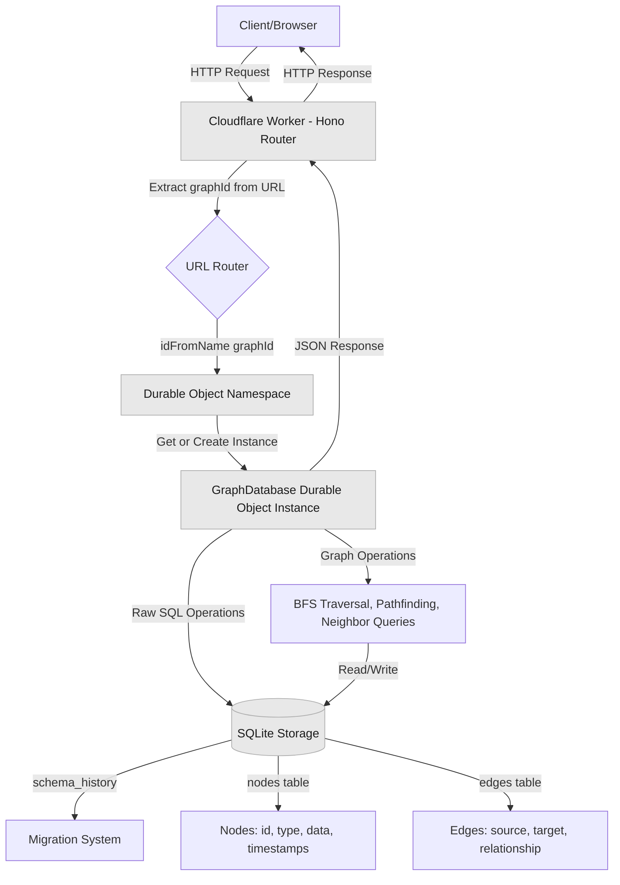

# Durable Objects Graph Database

**Create unlimited, isolated graph databases on Cloudflare's edge network.**

This project demonstrates how to build scalable graph databases using Cloudflare Durable Objects and SQLite. Each graph gets its own Durable Object instance with isolated storage, enabling you to create as many independent graph databases as you need.

## Why Unlimited Graph Databases?

Traditional graph databases require managing infrastructure for each database instance. With Durable Objects, you can dynamically create isolated graph databases on-demand:

- **Multi-tenancy**: Each user, organization, or project gets their own graph
- **AI/Graph-RAG Applications**: Perfect for building knowledge graphs for AI agents where each user needs their own context
- **Experimentation**: Spin up temporary graphs for testing, simulations, or sandboxes


## Quick Start

```bash
# Install dependencies
npm install

# Deploy to Cloudflare
npm run deploy

# Or run locally
npm run dev
```

## Overview

Each graph is identified by a `graphId` in the URL, automatically creating an isolated Durable Object:

```
POST /api/my-knowledge-graph/nodes        # Creates/uses graph "my-knowledge-graph"
POST /api/user-123-context/nodes          # Creates/uses graph "user-123-context"
POST /api/agent-memory-alice/nodes        # Creates/uses graph "agent-memory-alice"
```

**Key Features:**
- Full CRUD operations for nodes and edges
- Graph traversal with pathfinding
- Relationship queries (inbound, outbound, bidirectional)
- JSON properties on nodes and edges
- Runs globally on Cloudflare's edge network
- Interactive web UI for visualization and management

## Web Interface

This demo includes a web interface for interacting with your graph databases visually. The UI is vibe-coded.


## Architecture



### How It Works

1. **Worker Router**: Routes requests based on `graphId` in the URL
2. **Durable Object per Graph**: Each unique `graphId` gets its own isolated instance
3. **SQLite Storage**: Each instance has its own SQLite database for nodes and edges
4. **Automatic Creation**: New graphs are created on-demand when first accessed
5. **Graph Operations**: Traversal, pathfinding, and queries run within each instance

### Data Model

**Nodes:**
```typescript
{
  id: string                    // Unique identifier
  type: string                  // Node category (e.g., "person", "document")
  data: Record<string, any>     // Arbitrary JSON properties
  createdBy: string
  created: Date
  updated: Date
}
```

**Edges:**
```typescript
{
  source: string                // Source node ID
  target: string                // Target node ID
  relationship: string          // Edge type (e.g., "knows", "references")
  properties?: Record<string, any>  // Optional JSON properties
  createdBy: string
  created: Date
  updated: Date
}
```

## API Reference

All endpoints are scoped by `graphId`. Replace `:graphId` with your graph identifier.

### Nodes

| Method | Endpoint | Description |
|--------|----------|-------------|
| POST | `/api/:graphId/nodes` | Create a node |
| GET | `/api/:graphId/nodes/:nodeId` | Get a node by ID |
| GET | `/api/:graphId/nodes` | List nodes (supports `?type=`, `?limit=`, `?offset=`) |
| DELETE | `/api/:graphId/nodes/:nodeId` | Delete a node (cascade deletes edges) |

### Edges

| Method | Endpoint | Description |
|--------|----------|-------------|
| POST | `/api/:graphId/edges` | Create an edge |
| GET | `/api/:graphId/edges` | List edges (supports `?nodeId=`, `?relationship=`) |
| DELETE | `/api/:graphId/edges/:source/:relationship/:target` | Delete an edge |

### Graph Operations

| Method | Endpoint | Description |
|--------|----------|-------------|
| GET | `/api/:graphId/nodes/:nodeId/neighbors` | Get neighbors (supports `?direction=inbound\|outbound\|both`) |
| POST | `/api/:graphId/traverse` | Traverse graph / find shortest path |
| GET | `/api/:graphId/stats` | Get graph statistics |

### Example: Create a Knowledge Graph

```bash
# Create document nodes
curl -X POST https://your-worker.workers.dev/api/ai-knowledge-base/nodes \
  -H "Content-Type: application/json" \
  -d '{"id": "doc1", "type": "document", "data": {"title": "Graph Databases"}, "userId": "system"}'

curl -X POST https://your-worker.workers.dev/api/ai-knowledge-base/nodes \
  -H "Content-Type: application/json" \
  -d '{"id": "concept1", "type": "concept", "data": {"name": "Traversal"}, "userId": "system"}'

# Create relationship
curl -X POST https://your-worker.workers.dev/api/ai-knowledge-base/edges \
  -H "Content-Type: application/json" \
  -d '{"source": "doc1", "target": "concept1", "relationship": "mentions", "userId": "system"}'

# Traverse to find related concepts
curl -X POST https://your-worker.workers.dev/api/ai-knowledge-base/traverse \
  -H "Content-Type: application/json" \
  -d '{"startNodeId": "doc1", "maxDepth": 3}'
```

## Use Case Examples

### AI Agent with Personalized Memory

Each AI agent gets its own knowledge graph to store context, relationships, and learned information:

```typescript
// Agent stores a new fact
await fetch('/api/agent-alice/nodes', {
  method: 'POST',
  body: JSON.stringify({
    id: 'user-preference-1',
    type: 'preference',
    data: { category: 'food', item: 'pizza', sentiment: 'loves' },
    userId: 'agent-alice'
  })
});

// Agent creates relationship between entities
await fetch('/api/agent-alice/edges', {
  method: 'POST',
  body: JSON.stringify({
    source: 'user-preference-1',
    target: 'restaurant-123',
    relationship: 'related_to',
    userId: 'agent-alice'
  })
});

// Agent recalls context by traversing relationships
const context = await fetch('/api/agent-alice/traverse', {
  method: 'POST',
  body: JSON.stringify({ startNodeId: 'current-conversation', maxDepth: 3 })
});
```

### Multi-Tenant Graph-RAG System

Each user's documents are stored in their own isolated graph for retrieval:

```typescript
// User uploads document, entities extracted by LLM
const userId = 'user-123';
await fetch(`/api/${userId}-knowledge/nodes`, {
  method: 'POST',
  body: JSON.stringify({
    id: 'doc-abc',
    type: 'document',
    data: { title: 'Project Plan', embedding: [...] },
    userId
  })
});

// Link extracted entities
await fetch(`/api/${userId}-knowledge/edges`, {
  method: 'POST',
  body: JSON.stringify({
    source: 'doc-abc',
    target: 'entity-deadline',
    relationship: 'contains',
    properties: { confidence: 0.95 }
  })
});

// RAG query: traverse from query entities to find relevant docs
const relevant = await fetch(`/api/${userId}-knowledge/traverse`, {
  method: 'POST',
  body: JSON.stringify({
    startNodeId: 'entity-deadline',
    maxDepth: 2,
    direction: 'inbound'  // Find docs that reference this entity
  })
});
```
